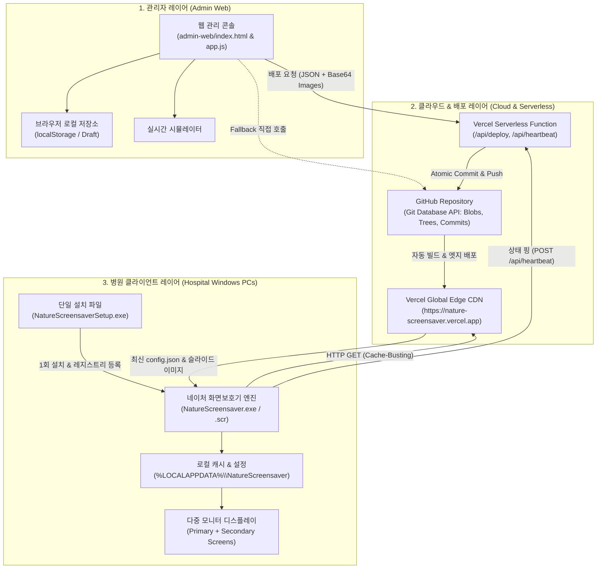
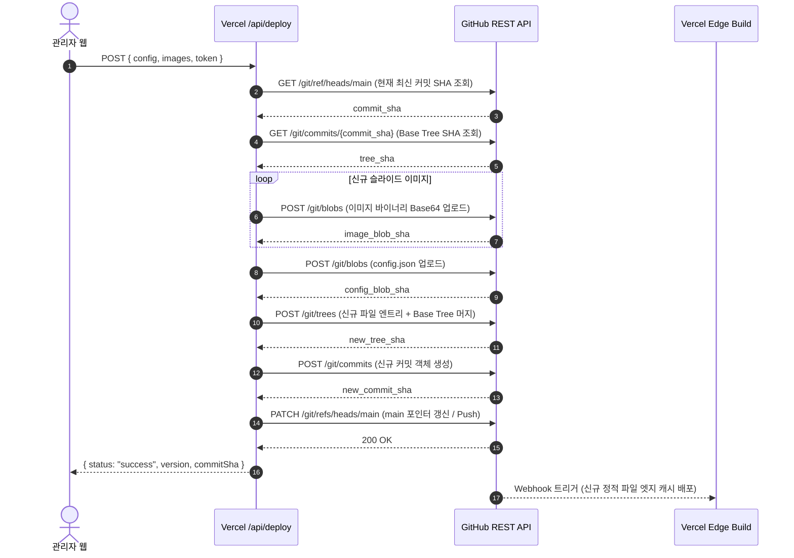

# 네이처 화면보호기 (Nature Screensaver) 종합 기술 명세서
**Document Version:** 2.0.0  
**Target Platform:** Windows 10/11 (x64), Modern Web Browsers, Vercel Edge Network  
**Target Organization:** 네이처 요양병원 (4주기 의료기관 인증평가 대비)

---

## 1. 시스템 개요 (System Overview)

네이처 화면보호기 시스템은 **병원 내 진료실, 원무과, 간호스테이션 등 전 PC의 유휴 화면을 활용하여 4주기 의료기관 인증평가 대비 공지 및 필수 교육 자료를 실시간으로 송출**하고, 자리를 비울 때 EMR(전자의무기록) 환자정보를 완벽히 은폐하기 위해 구축된 통합 디스플레이 솔루션입니다.

### 1.1 핵심 설계 목표
1. **Zero-Maintenance 클라이언트:** 병원 PC 1회 설치 후 추가 프로그램 설치나 조작 없이 원격 자동 동기화.
2. **4중 데이터 보존(4-Tier Persistence):** 데이터 유실 위험 0%를 보장하는 무중단 분산 스토리지 구조.
3. **듀얼/다중 모니터 EMR 완벽 보안:** 모든 연결된 디스플레이에 화면보호기를 동시 렌더링하여 환자정보 노출 방지.
4. **오프라인 무중단 연속성:** 내부망 장애 또는 인터넷 단선 시에도 로컬 캐시를 통한 지속 재생.
5. **원클릭 클라우드 배포:** 복잡한 인프라나 별도 호스팅 비용 없이 Vercel + GitHub + Inno Setup 기반의 서버리스 아키텍처 운영 ($0 TCO).

---

## 2. 시스템 아키텍처 (System Architecture)



### 2.1 4중 데이터 보존 아키텍처 (4-Tier Persistence)

| 계층 (Tier) | 저장 위치 | 저장 내용 | 역할 및 특징 |
|:---|:---|:---|:---|
| **Tier 1 (Admin Local)** | 관리자 웹 브라우저 (`localStorage`) | 슬라이드 초안, 임시 편집 상태, 과거 30개 배포 스냅샷 | 작업 중 브라우저 새로고침이나 탭 종료 시 작업 내용 즉시 복원 |
| **Tier 2 (Permanent VCS)** | GitHub `main` 브랜치 (`admin-web/slides/`, `config.json`) | 슬라이드 바이너리 이미지, 배포 버전 설정 원본 | Git Tree/Commit 형태의 영구 불변 형상 관리 (이력 추적 및 복원 가능) |
| **Tier 3 (Global Edge CDN)** | Vercel Edge Network | 캐시 제어된 정적 자산 및 Serverless 엔드포인트 | 전 세계 엣지 네트워크를 통한 병원 PC 고속 다운로드 및 무중단 서빙 |
| **Tier 4 (Client Offline)** | 클라이언트 PC (`%LOCALAPPDATA%\NatureScreensaver\cache`) | 다운로드된 PNG/JPG 이미지, `last-config.json`, `sync.log` | 인터넷 일시 단선 시에도 100% 정상 작동하는 오프라인 폴백 캐시 |

---

## 3. 서브시스템별 기술 상세 (Component Specifications)

### 3.1 윈도우 클라이언트 엔진 (`client/`)

* **프레임워크 및 언어:** C# (.NET 8.0-windows), Windows Forms, GDI+
* **컴파일 파라미터:**
  * `PublishSingleFile=true`: 단일 바이너리 패키징
  * `SelfContained=true`: 대상 PC에 .NET 런타임 미설치 상태에서도 독립 실행
  * `RuntimeIdentifier=win-x64`: 64비트 최적화
  * `EnableCompressionInSingleFile=true`: 단일 파일 내장 압축 적용 (약 66MB)

#### A. 윈도우 화면보호기 수명주기 및 명령줄 인터페이스
윈도우 OS의 화면보호기 표준 실행 프로토콜을 구현합니다:
```csharp
var mode = args.Length > 0 ? args[0].ToLowerInvariant() : "/s";
```
* `/s`: 화면보호기 전체화면 실행 (기본 동작).
* `/c`: 화면보호기 환경설정 창 호출 (`MessageBox`를 통해 현재 `settings.json`, `last-config.json`, `sync.log` 최신 400자 표시).
* `/p <HWND>`: 윈도우 '화면 보호기 설정' 창 내부의 모니터 미리보기 패널 핸들(`IntPtr`)을 상속받아 임베디드 렌더링.

#### B. 다중 모니터 (Multi-Monitor) 방어 로직
```csharp
var screens = Screen.AllScreens;
foreach (var screen in screens)
{
    var isPrimary = screen.Primary;
    var form = new ScreensaverForm(screen, isPrimary);
    form.Show();
}
```
* 연결된 모든 모니터의 경계(`screen.Bounds`)에 맞추어 개별 무테두리 윈도우(`FormBorderStyle.None`, `TopMost = true`)를 인스턴스화합니다.
* **주 화면(Primary) 독점 위임:** 네트워크 동기화(`_syncTimer`), 원격 설정 다운로드, 하트비트 전송은 Primary 화면보호기 인스턴스만 단독 수행하여 중복 트래픽 및 파일 I/O 충돌을 방지합니다.

#### C. 고품질 렌더링 & 더블 버퍼링 (GDI+)
* 깜빡임(Flickering) 방지를 위해 하드웨어 가속 수준의 메모리 더블 버퍼링 적용:
  ```csharp
  SetStyle(ControlStyles.AllPaintingInWmPaint | ControlStyles.UserPaint | ControlStyles.OptimizedDoubleBuffer, true);
  UpdateStyles();
  ```
* `InterpolationMode.HighQualityBicubic`, `SmoothingMode.HighQuality`, `PixelOffsetMode.HighQuality` 그래픽스 파이프라인.
* 이미지 종횡비 유지 (`Contain` 모드 자동 레터박스/필러박스 계산).

#### D. 크로스페이드 (Cross-Fade) 알파 블렌딩 엔진
50FPS(`_animTimer.Interval = 20ms`)의 보간 엔진을 통해 슬라이드 전환 시 부드러운 페이드 인/아웃을 구현합니다:
$$\alpha(t) = \text{clamp}(t, 0.0, 1.0)$$
`ColorMatrix`의 `Matrix33`에 $\alpha$ 값을 대입하여 `ImageAttributes`를 통해 렌더링된 두 이미지 버퍼를 실시간 혼합:
```csharp
var cm = new ColorMatrix { Matrix33 = Math.Clamp(alpha, 0.0f, 1.0f) };
using var ia = new ImageAttributes();
ia.SetColorMatrix(cm, ColorMatrixFlag.Default, ColorAdjustType.Bitmap);
g.DrawImage(img, destRect, 0, 0, img.Width, img.Height, GraphicsUnit.Pixel, ia);
```

#### E. 하단 글래스모피즘 오버레이 바
* 높이 44px의 반투명 어두운 바 (`ARGB(170, 10, 15, 20)`) 및 1px 상단 테두리 (`ARGB(40, 255, 255, 255)`).
* **좌측:** 1초 주기로 갱신되는 실시간 디지털 시계 (`yyyy.MM.dd (ddd) HH:mm:ss`).
* **중앙:** 병원 공지 문구.
* **우측:** 실시간 인증평가 D-Day 자동 계산 배지 (`D-Day`, `D-n`, `D+n`).

#### F. 입력 인터럽트 방어 (False Positive Wakeup Guard)
* 마우스의 미세 진동이나 데스크 충격으로 인해 화면보호기가 꺼지는 문제를 방지:
  1. 기동 후 1,000ms 동안은 키보드/마우스 클릭 이벤트 무시.
  2. 기동 후 1,500ms 유예 후, 최초 마우스 위치로부터 유클리드 거리 20px 이상 이동 시에만 종료 (`Application.Exit()`).

---

### 3.2 웹 관리자 콘솔 (`admin-web/`)

* **스택:** Pure Vanilla HTML5, Modern CSS (Glassmorphism, CSS Custom Properties), ES2022 JavaScript.
* **디자인 토큰:**
  * 폰트: `Pretendard`, `JetBrains Mono`
  * 테마: 고대비 다크 모드 (`#0b0f17`, `#111827`, `#10b981` 에메랄드 액센트)
* **보안:**
  * 핀/비밀번호 잠금 오버레이 (`authLockScreen`)
  * `sessionStorage` 기반 세션 유지 및 비밀번호 변경 기능 (`localStorage` 암호화 저장소)

#### A. 슬라이드 관리 & 인터랙션
* **멀티 이미지 드래그앤드롭:** PPT에서 내보낸 이미지들을 드롭 영역에 놓으면 브라우저 `FileReader`를 통해 인메모리 Base64 DataURL로 변환 후 슬라이드 카드 즉시 생성.
* **HTML5 네이티브 Drag & Drop 정렬:** 카드 순서 재배치(`dragstart`, `dragover`, `drop`) 시 실시간 순번 및 배포 번호 동기화.
* **D-Day 계산기:** 목표 날짜 설정 시 실시간 일수 계산 및 배지 미리보기 연동.

#### B. 실시간 시뮬레이터 (`simulatorModal`)
* 병원 PC 화면과 100% 동일한 화면 비율과 하단 오버레이를 브라우저 내에서 직접 구동하여 배포 전 최종 검수 제공.

#### C. 배포 이력(History) 및 원클릭 롤백
* 배포 시점마다 설정 스냅샷을 브라우저에 최대 30개 버전까지 저장.
* 문제 발생 시 과거 특정 버전의 **[이 버전으로 복원]** 버튼 클릭 한 번으로 모든 슬라이드 구성 원상 복구.

---

### 3.3 백엔드 & 서버리스 API (`api/`, `scripts/dev-server.js`)

#### A. 배포 파이프라인 (`/api/deploy` & `api/deploy.js`)
Git의 Low-Level Object API를 직접 사용하여 단일 원자적 커밋(Atomic Commit)을 생성합니다:



#### B. 구글 슬라이드 자동 파싱 엔드포인트 (`/api/google-slides`)
* **역할:** 관리자 웹에서 구글 슬라이드 문서 링크 입력 시, 프레젠테이션의 모든 슬라이드를 감지하고 각 페이지의 고화질 이미지 내보내기 URL 목록을 자동 생성하여 반환.
* **엔드포인트:** `POST /api/google-slides` (또는 `GET /api/google-slides?url=...`)
* **입력:** `{ "url": "https://docs.google.com/presentation/d/{ID}/edit" }`
* **동작 원리:**
  1. 정규표현식으로 Presentation ID 추출.
  2. 구글 슬라이드 웹 문서 조회 (`/edit`, `/htmlpresent`, `/pub`).
  3. 문서 제목 및 각 슬라이드의 Page ID (`p`, `p1`, `g...`) 파싱.
  4. 각 페이지별 고화질 PNG 내보내기 URL 생성 (`export/png?id={ID}&pageid={PAGE_ID}`).
* **출력:** `{ "status": "success", "title": "프레젠테이션 제목", "totalSlides": 8, "slides": [ ... ] }`

#### C. 원내 PC 가동 상태 모니터링 (`/api/heartbeat`)
* **엔드포인트:**
  * `POST /api/heartbeat`: 클라이언트 PC가 동기화 시 장비명, 계정명, 적용 버전, 모니터 개수, OS 정보를 전송.
  * `GET /api/heartbeat`: 관리자 웹에서 최근 통신된 PC 목록(최근 100대) 및 온라인 상태 조회.

---

### 3.4 패키징 & 배포 인스톨러 (`installer/`)

* **도구:** Inno Setup 6 (`NatureScreensaver.iss`)
* **특징:**
  * `PrivilegesRequired=lowest`: 관리자 권한(UAC) 창 없이 일반 윈도우 계정에서도 즉시 설치 가능.
  * 설치 경로: `%LOCALAPPDATA%\Programs\NatureScreensaver`
  * 설치 완료 후 `NatureScreensaver.exe`를 `NatureScreensaver.scr`로 자동 복제.
  * **윈도우 레지스트리 자동 구성:**
    * `HKCU\Control Panel\Desktop\SCRNSAVE.EXE` = `{app}\NatureScreensaver.scr`
    * `HKCU\Control Panel\Desktop\ScreenSaveActive` = `"1"`
    * `HKCU\Control Panel\Desktop\ScreenSaveTimeOut` = `"600"` (10분 유휴 시 자동 기동)

---

## 4. 데이터 스키마 및 통신 규약 (Data Contracts)

### 4.1 배포 설정 파일 (`config.json`)
```json
{
  "$schema": "http://json-schema.org/draft-07/schema#",
  "version": "2026.10.03.2045",
  "updateIntervalMinutes": 10,
  "slideDurationSeconds": 15,
  "backgroundColor": "#050505",
  "fitMode": "contain",
  "notice": "네이처 요양병원 의료기관 인증평가 대비 원내 공지",
  "dDayTitle": "4주기 인증평가",
  "dDayDate": "2026-11-25",
  "slides": [
    {
      "order": 1,
      "title": "슬라이드1",
      "fileName": "슬라이드1.PNG",
      "url": "https://nature-screensaver.vercel.app/slides/슬라이드1.PNG",
      "durationSeconds": 15
    }
  ]
}
```

### 4.2 클라이언트 로컬 설정 (`settings.json`)
```json
{
  "configUrl": "https://nature-screensaver.vercel.app/config.json"
}
```

### 4.3 하트비트 전송 페이로드 (`POST /api/heartbeat`)
```json
{
  "machineName": "DESKTOP-NATURE01",
  "userName": "nurse_station",
  "screenCount": 2,
  "version": "2026.10.03.2045",
  "slidesCount": 8,
  "os": "Microsoft Windows NT 10.0.19045.0"
}
```

---

## 5. 보안 및 안전성 분석 (Security & Reliability)

1. **환자 정보(EMR) 노출 방지:**
   - 듀얼/트리플 모니터 환경에서 주 모니터뿐만 아니라 모든 확장 모니터에도 즉시 전체화면 윈도우가 최상위(`TopMost`)로 렌더링되므로, 자리를 비울 때 EMR 차트 화면이 외부에 노출되지 않습니다.
2. **토큰 보안성:**
   - 관리자 웹에서 GitHub 토큰(`GITHUB_TOKEN`)을 Vercel 환경 변수로 등록 시 클라이언트에 토큰이 노출되지 않고 서버리스 API 내부에서 안전하게 실행됩니다.
3. **네트워크 장애 내결함성:**
   - 클라이언트 다운로드 시 타임아웃(25초)과 HTTP No-Cache 헤더를 강제하여 프록시 오염을 방지하며, 동기화 실패 시 로컬 캐시 슬라이드로 즉시 폴백하여 화면보호기 재생이 멈추지 않습니다.
4. **캐시 버스팅 (Cache-Busting):**
   - Vercel `vercel.json`의 `Cache-Control: no-cache, no-store, must-revalidate` 및 요청 URL의 쿼리스트링 `?_cb=<timestamp>`를 통해 최신 배포본을 지연 없이 즉시 수신합니다.

---

## 6. 빌드 및 배포 자동화 (CI/CD)

* **GitHub Actions 워크플로우:** `.github/workflows/build-screensaver.yml`
  * `client/**` 또는 `installer/**` 변경 시 자동 트리거.
  * Windows 최신 가상환경에서 `dotnet publish` 및 Inno Setup `ISCC.exe`를 통해 단일 설치 패키지(`NatureScreensaverSetup.exe`)를 자동 빌드하고 Artifact로 생성.
* **설정값 유효성 검증:** `.github/workflows/validate-config.yml`
  * JSON 형식, 이미지 확장자 유효성, HTTPS URL, 양수 주기 등을 사전에 자동 검사.
