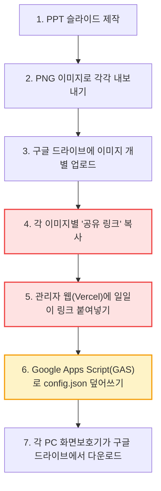

# 네이처 화면보호기 시스템 워크플로우 리뷰 및 개선 보고서

**작성일시**: 2026-09-04  
**대상 시스템**: Nature Screensaver (관리자 웹앱, Windows 화면보호기 클라이언트, Google 배포 파이프라인)

---

## 1. 개요 및 현재 워크플로우 진단 (AS-IS)

현재 시스템은 서버 유지비용 0원(Vercel + Google Drive + GitHub)으로 구현된 매우 경제적이고 가벼운 아키텍처입니다. 하지만 실제 병원 현장에서 운영할 때 관리자가 느끼는 **수동 작업의 피로도와 단계적 복잡성**이 존재합니다.

### 🔴 현재 워크플로우의 주요 병목 및 복잡점

1. **링크 개별 복사 노가다 (가장 큰 불편)**
   - 슬라이드가 10장~20장으로 늘어날 경우, 구글 드라이브에서 10~20개의 링크를 개별적으로 복사해서 웹에 붙여넣어야 합니다.
2. **Google Apps Script(GAS) 최초 세팅의 진입장벽**
   - 최초 1회 작업이지만 `script.google.com`에서 프로젝트를 만들고, 코드를 붙여넣고, `FILE_ID`를 찾고, '안전하지 않음' 권한을 승인하는 과정은 비개발자 관리자에게 다소 어렵고 번거롭습니다.
3. **작업 내용의 브라우저 로컬 저장 한계 (동기화 부재)**
   - 설정 초안이 브라우저 `localStorage`에만 저장되므로, 관리자 PC가 바뀌거나 다른 담당자가 웹에 접속하면 기존 슬라이드 목록이 보이지 않아 매번 JSON 파일을 다시 불러와야 합니다.
4. **구글 드라이브 다운로드 URL의 불안정성**
   - 구글 드라이브의 직접 다운로드 링크(`uc?export=download&id=...`)는 구글 측 트래픽 제한이나 바이러스 검사 경고창이 뜰 경우 이미지가 아닌 HTML이 다운로드되어 화면보호기가 이미지를 읽지 못할 잠재적 위험이 있습니다.

---

## 2. 워크플로우 개선을 위한 선택지 (3가지 옵션)

| 구분 | **옵션 A: 구글 드라이브 폴더 자동인식 (비용 0원)** | **옵션 B: 웹 직접 업로드 + Vercel 스토리지 (비용 0원)** | **옵션 C: PPT 직접 업로드 완전자동화 (올인원 CMS)** |
| :--- | :--- | :--- | :--- |
| **운영 방식** | 구글 드라이브 **폴더 1개 링크**만 넣으면 내부 이미지를 자동 감지 | 관리자 웹에서 이미지를 **드래그앤드롭 업로드** (구글 드라이브 불필요) | 관리자 웹에 **PPTX 파일**만 던지면 끝 |
| **관리자 작업** | 1. PPT를 PNG로 내보내 폴더에 업로드 2. 웹에서 '폴더 동기화' 버튼 클릭 | 1. 웹에서 이미지 파일들을 마우스로 끌어다 놓기 2. [배포] 클릭 | 1. 파워포인트 파일(.pptx) 업로드 2. [배포] 클릭 |
| **인프라/비용** | Vercel 무료 + 구글 드라이브 무료 ($0) | Vercel 무료 (Vercel Blob/Edge Config 무료티어 $0) | 백엔드 서버(Node.js LibreOffice 컨버터) 필요 (월 소액 또는 로컬) |
| **구현 난이도** | 보통 (GAS 코드에 폴더 파일 리스트 반환 추가) | 보통~쉬움 (Vercel Serverless API 연동) | 높음 (PPTX 슬라이드 자동 렌더링 엔진 구축) |
| **장점** | 익숙한 구글 드라이브 그대로 사용, 링크 복사 완전히 사라짐 | **구글 드라이브/GAS 세팅 전면 폐지**, 링크 복사 없음, 가장 깔끔함 | 파워포인트 내보내기조차 필요 없음 |
| **단점** | 여전히 GAS 1회 연동 필요 | Vercel 무료 한도(스토리지 1GB) 내 운영 (병원 슬라이드용으론 수천 장 가능하여 충분) | 구현 공수가 큼 |

---

## 3. 관리자(사용자)가 선택해야 할 사항 리스트

원무과장님께서 다음 3가지 사항에 대해 결정해주시면 맞춤형으로 최적화할 수 있습니다:

### Q1. 슬라이드 이미지를 어디에 올려두고 관리하고 싶으신가요?
- **[선택 1] 구글 드라이브 유지**: 기존 병원 업무용 구글 드라이브 폴더에 슬라이드 이미지를 모아두고 싶음.
- **[선택 2] 관리자 웹에 직접 업로드**: 구글 드라이브 들락날락할 필요 없이, 네이버 블로그 사진 올리듯 관리자 웹 화면에 바로 이미지들을 끌어다 올려서 배포하고 싶음.

### Q2. 기존 설정(이전 슬라이드들)을 여러 PC/담당자와 공유해야 하나요?
- **[선택 1] 필요 없음**: 내 자리 PC 1대에서만 주로 수정하므로 현재 방식(브라우저 저장)으로 충분함.
- **[선택 2] 필요함**: 다른 자리나 다른 직원도 관리자 웹에 들어가면 현재 배포 중인 슬라이드 목록이 자동으로 그대로 떠야 함.

### Q3. 파워포인트(PPT) ➔ 이미지 변환 작업을 줄이고 싶으신가요?
- **[선택 1] 파워포인트에서 "다른 이름으로 저장 ➔ PNG"는 어렵지 않으므로 유지**.
- **[선택 2] PPT 파일 자체를 올려서 바로 화면보호기로 나오게 만들고 싶음**.

---

## 4. 추천 방향 (AI 엔지니어 권장 로드맵)

> **💡 강력 추천: "단계적 최적화 - 1단계(옵션 A) 즉시 적용 ➔ 2단계(옵션 B) 전환"**

### [1단계 - 지금 즉시 추천: 옵션 A 개량형] "폴더 링크 1개로 끝내기"
1. **링크 개별 복사 폐지**:
   - 구글 드라이브에 `[네이처_슬라이드]` 폴더를 만들고, 거기에 PNG들을 한꺼번에 업로드합니다.
   - 관리자 웹에는 **폴더 링크 딱 1개**만 붙여넣고 `[폴더에서 슬라이드 자동 불러오기]`를 누르면, 폴더 안에 있는 10개든 20개든 이미지를 순서대로 싹 긁어와 슬라이드 목록을 자동 생성합니다.
2. **효과**:
   - 기존의 무료 인프라(Vercel + Google Drive)를 100% 유지하면서,
   - 가장 번거로운 **"파일 링크 일일이 복사해서 붙여넣기" 작업이 10초 만에 끝나는 작업으로 단축**됩니다.

### [2단계 - 차기 추천: 옵션 B] "구글 드라이브와 GAS를 완전히 걷어내기"
- Vercel에 무료 스토리지(Vercel Blob)를 연동하여,
- 구글 드라이브 로그인, GAS 세팅, URL 복사 같은 외부 과정을 완전히 없애고,
- **웹 관리자 페이지 안에서 이미지 드래그앤드롭 ➔ [즉시 배포] 클릭 한 번**으로 끝내는 완전체 웹앱으로 전환합니다.

---

## 5. 최종 결정 및 옵션 B 구현 완료 (2026-09-04)

원무과장님과의 논의 및 결정에 따라 **[옵션 B (웹 직접 업로드 + 배포 이력 관리 + 자동 백업) 및 듀얼 모니터 완벽 지원]**으로 아키텍처 개선을 완료했습니다.

### 반영 완료된 기능 목록:
1. **멀티 이미지 드래그 & 드롭 자동 생성**:
   - 구글 드라이브 링크를 일일이 복사할 필요 없이, PPT에서 내보낸 PNG/JPEG 파일들을 관리자 웹 배너에 마우스로 끌어다 놓으면 즉시 슬라이드 카드가 자동 생성됩니다.
2. **배포 이력(History) 스냅샷 및 원클릭 롤백**:
   - 배포할 때마다 버전별 슬라이드 구성이 스냅샷으로 영구 보관되며, `[배포 이력]` 모달에서 과거 원하는 시점으로 1초 만에 복원(롤백)할 수 있습니다.
3. **구글 드라이브 자동 백업 연동 유지**:
   - Google Apps Script 연동 시 구글 드라이브에도 설정과 파일이 동시 덮어쓰기 백업되도록 하이브리드 지원.
4. **듀얼/다중 모니터 완벽 지원 (`client/Program.cs`)**:
   - 원내 듀얼 모니터 환경에 대응하여, 연결된 모든 모니터(`Screen.AllScreens`)에 전체화면 슬라이드가 동시에 뜨도록 클라이언트 코드를 개선했습니다.
   - 키보드나 마우스 조작 시 양쪽 화면보호기가 동시에 부드럽게 해제됩니다.

